<div align="center">


# MARKETS

**A £0 Bloomberg-style research terminal — deep on one company, broad across the S&P 500.**

Every SEC filing, every XBRL fact and segment, every insider trade, every 13F holder, every earnings<br/>
reaction, decades of prices — archived locally, normalized into SQLite, explored in a fast dark<br/>
dashboard or a multi-panel, multi-monitor workspace.


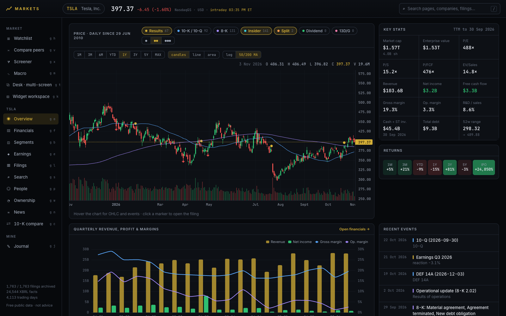

</div>

> [!IMPORTANT]
> Research and paper-trading tool, **not financial advice**. Data is free and public — daily /
> delayed, not real-time. A terminal is not an edge; the habit of writing a thesis and a stop
> *before* you trade is. That's what the Journal page is for.

---

## ⚡ Quick start

```sh
./markets add TSLA               # resolve ticker → SEC CIK, start tracking
./markets update TSLA            # fetch everything new, then rebuild the database
./markets serve --open           # → http://localhost:5800
```

| Want to… | Run |
|---|---|
| Track the whole S&P 500 (prices + financials) | `./markets universe sp500` → `./markets update all` |
| Track a peer without the 2 GB archive | `./markets add GM --lite` |
| Track a ticker as prices + financials only | `./markets add NVDA --core` |
| Track a London listing | `./markets add RR.L --ch 07524813` *(Companies House needs a free key in `MARKETS_CH_KEY`)* |
| Refresh everything | `./markets update all` |
| Fast refresh (no filings) | `./markets update TSLA --skip-filings` |
| Rebuild the DB from the archive, offline | `./markets rebuild` |
| See what's archived | `./markets status` |
| Nightly auto-update (Tue–Sat 04:15) | `scripts/nightly.sh install` · `status` · `log` · `uninstall` |

**Tiers** — choose depth per ticker:

| Tier | What you get | Cost (TSLA-sized) |
|---|---|---|
| `full` | everything: every filing & exhibit, full-text search, 10-K diffs, insiders, proxies, segments, earnings text | ~2 GB raw, ~30 min first run |
| `lite` | prices, financials, segments (XBRL instances), earnings reactions, ownership + proxy filings, 13F | ~0.1–0.5 GB |
| `core` | prices, financials, filing index, earnings reactions, short interest — for broad universes | ~2–5 MB · ~20 s |

After the first run, updates only fetch what's new.

---

## 🗂️ What you get — per company

| | Data | Free source |
|---|---|---|
| 📜 | **Every filing, every exhibit**, readable offline | SEC EDGAR full-submission archive |
| 🧮 | **Income / balance / cash-flow statements**, annual + quarterly, restatement-aware | SEC XBRL companyfacts |
| 🧩 | **Segments** — revenue by product, business segment and geography; subtotals detected | each 10-K/10-Q's XBRL instance |
| 🎯 | **Earnings reactions** — gap, day, +5/+20 d, vs SPY, volume; the quarter's numbers YoY; guidance language | 8-K item 2.02 + prices |
| 📈 | **Daily prices since IPO**, splits, dividends — cross-checked against a second feed | Yahoo chart API ⟷ Nasdaq |
| 🕴️ | **Insiders** — every Form 3/4/5 transaction, holdings over time | EDGAR ownership XML |
| 🏦 | **13F institutions** — who holds it, who's buying, put/call positioning | SEC quarterly 13F data sets |
| 🐋 | **>5 % holders** (13D/13G) across three generations of format | EDGAR Schedule 13D/G |
| 💰 | **Executive & director pay** — summary comp table, pay-vs-performance | Proxy (DEF 14A) HTML + `ecd:` XBRL |
| 🩳 | **Short interest**, days to cover | FINRA consolidated short interest |
| 📰 | **News headlines**, accumulating every update | Google News RSS + GDELT |
| 🌦️ | **Macro context** — rates, curve, CPI, jobs, VIX, oil, dollar, BoE | FRED + Bank of England |
| 🔎 | **Full-text search** over every filing | SQLite FTS5 |
| ✍️ | **Your journal** — notes + paper trades with P&L and R-multiples | you |

## 🖥️ The dashboard

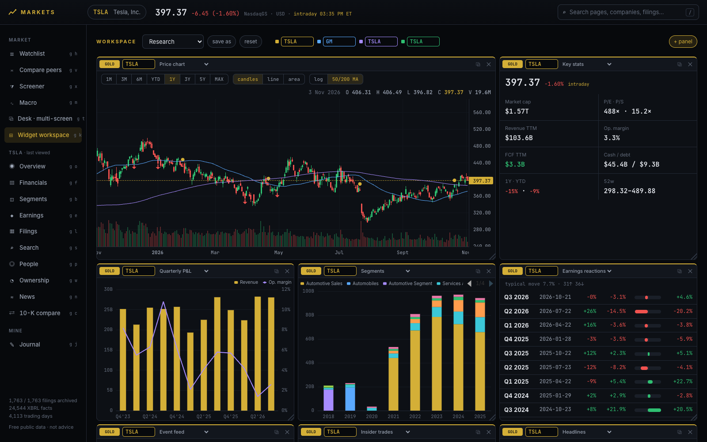

**Workspace** — a Bloomberg-style launchpad: drag, resize and mix any widgets; colour link groups (type
a ticker in any gold panel and every gold panel follows); named layouts; **pop any panel out to a second
monitor** and it stays linked.

<table>
<tr>
<td width="50%">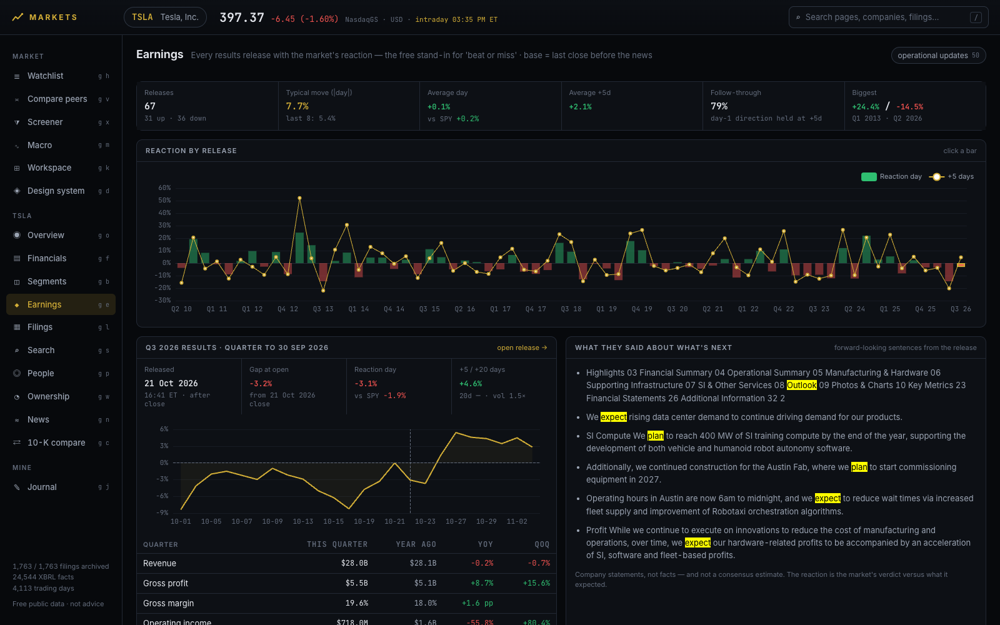<br/><b>Earnings</b> — every results release with the market's reaction (the free stand-in for consensus), the quarter vs a year ago, and what management said about what's next.</td>
<td width="50%">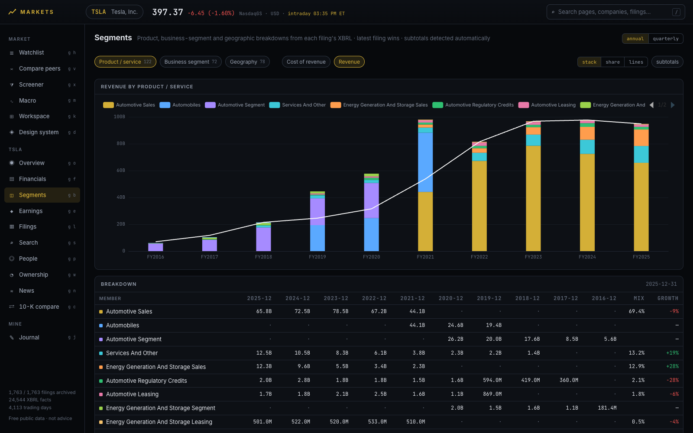<br/><b>Segments</b> — revenue by product / segment / geography, stacked, as mix, or as lines, reconciled against reported revenue.</td>
</tr>
<tr>
<td width="50%">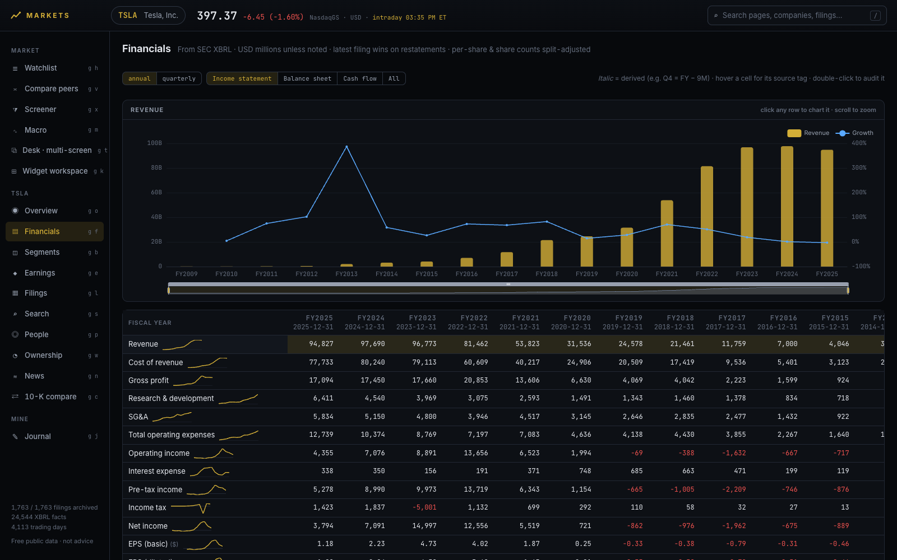<br/><b>Financials</b> — statements with sparklines; click a row to chart it, double-click a cell to audit every filing behind the number.</td>
<td width="50%">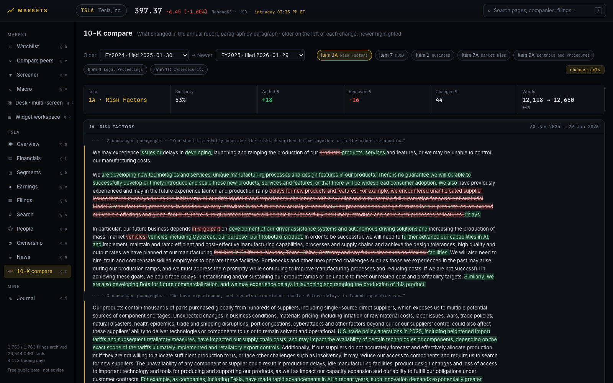<br/><b>10-K compare</b> — pick two years and an Item (Risk Factors, MD&A…): what was added, removed, reworded.</td>
</tr>
<tr>
<td>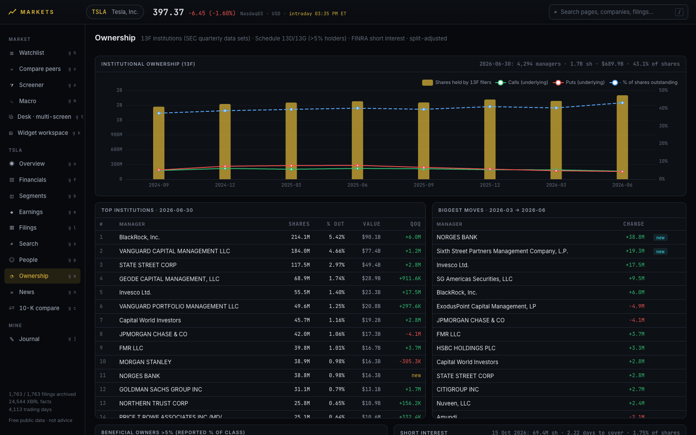<br/><b>Ownership</b> — 13F institutions, biggest movers, >5 % holders over time, short interest vs price.</td>
<td>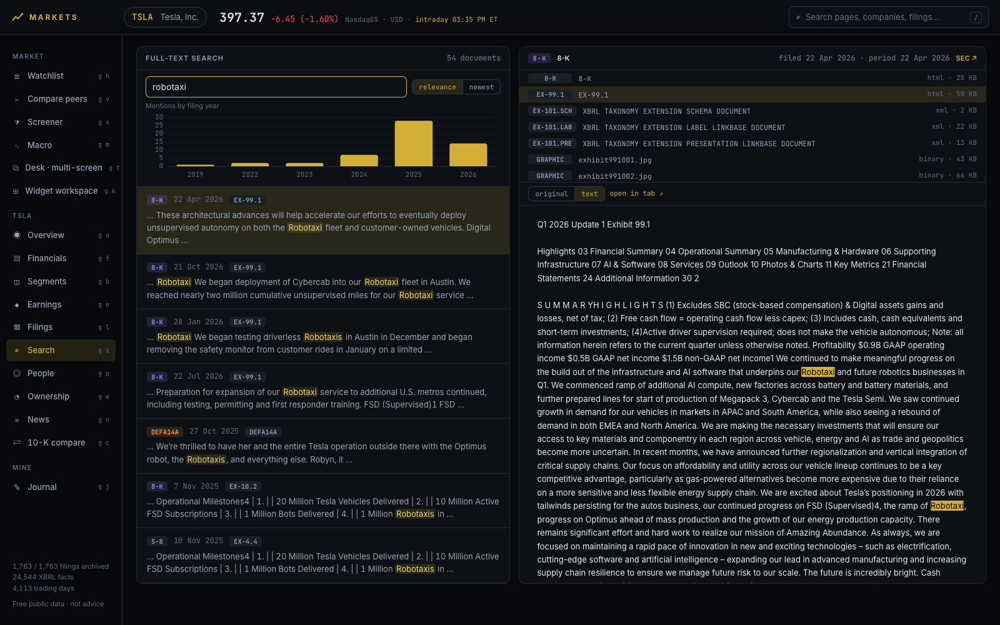<br/><b>Search</b> — full text across every 10-K, 10-Q, 8-K, proxy and exhibit, with a highlighted reader.</td>
</tr>
<tr>
<td>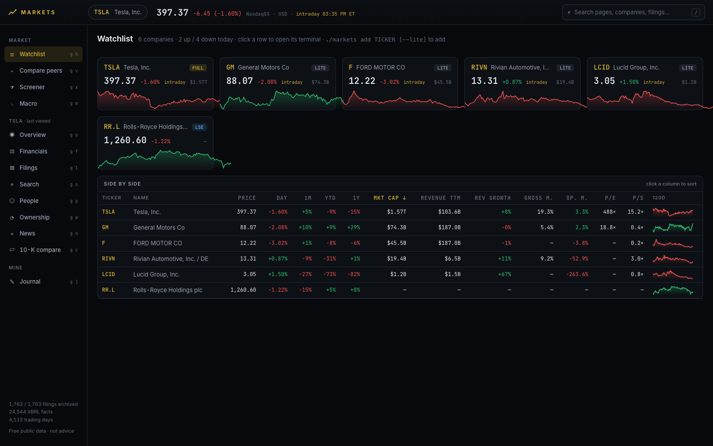<br/><b>Watchlist</b> — every tracked company at a glance; sortable side-by-side table.</td>
<td>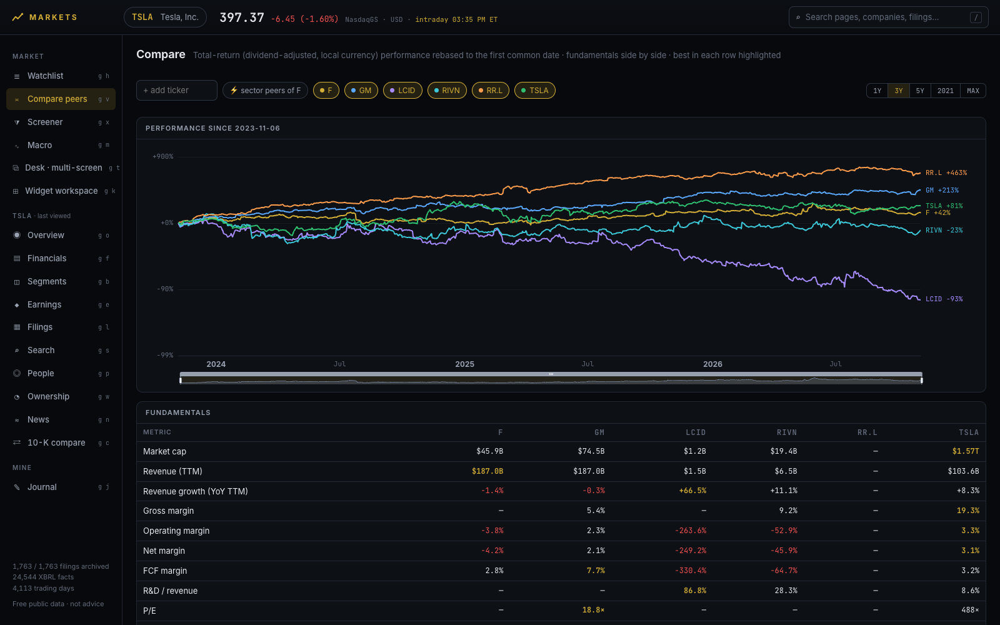<br/><b>Compare peers</b> — total-return race + fundamentals, best in each row highlighted.</td>
</tr>
<tr>
<td>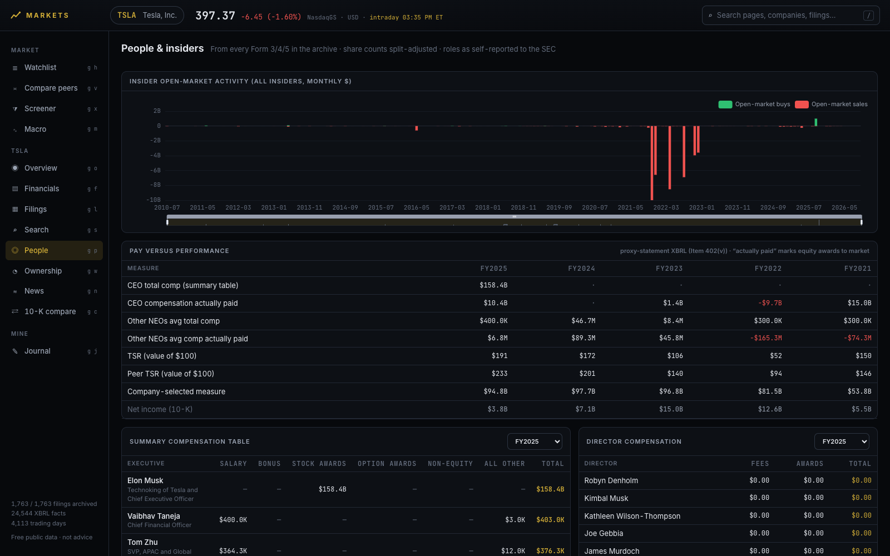<br/><b>People</b> — insiders, their trades and holdings; summary comp & director pay.</td>
<td>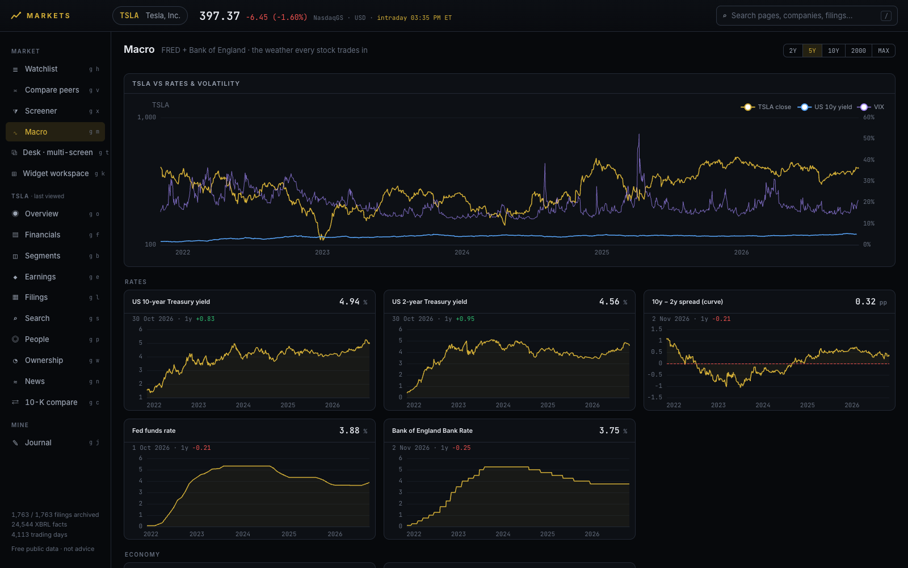<br/><b>Macro</b> — the weather every stock trades in, with your company overlaid on rates and VIX.</td>
</tr>
</table>

Also: **Filings** reader (every document & exhibit, sandboxed), **News**, **Screener** (the whole
universe, by sector), **Journal**, and a **Design system** page documenting every token and primitive.

**Keyboard:** `/` or `⌘K` palette · `g o` overview · `g f` financials · `g b` segments · `g e` earnings ·
`g l` filings · `g s` search · `g p` people · `g w` ownership · `g n` news · `g c` 10-K compare ·
`g j` journal · `g h` watchlist · `g v` peers · `g x` screener · `g m` macro · `g k` workspace · `g d` design

---

## 🧱 How it works

```mermaid
flowchart LR
  subgraph free["Free public sources"]
    SEC[SEC EDGAR<br/>filings · XBRL · 13F]
    PX[Yahoo ⟷ Nasdaq<br/>prices]
    FINRA[FINRA<br/>short interest]
    NEWS[Google News · GDELT]
    MAC[FRED · Bank of England]
    CH[Companies House]
  end
  free -->|net.py<br/>rate-limited, retried| RAW[("raw archive<br/>immutable · gzipped<br/>manifest.jsonl")]
  RAW -->|pure parsers<br/>./markets rebuild| DB[("markets.db<br/>SQLite + FTS5<br/>disposable")]
  DB --> API[stdlib JSON API<br/>127.0.0.1:5800]
  API --> UI[React dashboard]
  UI <-->|notes · paper trades| J[("journal.db<br/>yours — back it up")]
```

Three rules keep it trustworthy:

1. **The raw archive is the source of truth and is never edited.** Filings are write-once;
   changing sources get one dated snapshot per day; every fetch is logged with its SHA-256.
2. **The database is disposable.** `./markets rebuild` regenerates it from the archive with zero
   network in about a minute — so a parser fix is free and history is never lost.
3. **Your data is separate.** Notes and trades live in `journal.db` (plus an append-only
   `journal.log.jsonl`), never in the rebuildable store.

<details>
<summary><b>Project layout</b></summary>

```
markets                  CLI — add / update / rebuild / status / serve
backend/markets/
  net.py                 the only network code (per-host rate limits, retries, gzip)
  archive.py             immutable raw archive + manifest
  sources/               one module per source: fetch() + pure parse()
    edgar_*.py  form4.py  ownership_13dg.py  proxy.py  sec_13f.py
    prices.py  short_interest.py  news.py  macro.py  companies_house.py
  normalize/             raw → SQLite build steps (statements, insiders, events, FTS…)
  db/schema.sql          derived-store schema (versioned; stale DBs are recreated)
  journal.py             user data (journal.db)
  api/                   stdlib HTTP server + query layer
frontend/src/
  ui/                    design system primitives (Panel, Stat, Seg, Chip, Tag, Delta, Bar…)
  workspace/             multi-panel launchpad, widgets, pop-out windows
  pages/                 one file per page
launchd/ scripts/        nightly update job
tests/                   offline unittest suite on trimmed real payloads
docs/                    screenshots
data/                    (gitignored) companies/<T>/raw · reference/ · markets.db · journal.db
```
</details>

<details>
<summary><b>Honest limits</b></summary>

- No real-time ticks; no broker consensus estimates — neither is free.
- 13F data sets are kept for the last ~2 years (8 quarters, ~90 MB each, shared by all companies).
- Older 13G cover pages are parsed from free text; a few (e.g. FMR's) don't expose a percentage.
- Company-specific XBRL extensions aren't in companyfacts (e.g. Tesla's own CF D&A tag after 2018).
- Proxy tables are parsed from HTML heuristically; every row is checked to sum to its total.
- UK companies: prices + news + macro work out of the box; Companies House needs a free API key.
- No consensus estimates: "beat or miss" is approximated by the market's reaction. Guidance is
  extracted sentences, not structured numbers.
- Segment members occasionally overlap where a filing tags a parent line without all its children;
  the page flags those periods against reported revenue.
- Core-tier tickers don't keep filing text, so their earnings rows have reactions + numbers but no
  guidance excerpts.
</details>

## 🧪 Development

```sh
python3 -m unittest discover -s tests      # offline, ~0.1 s
cd frontend && npm install && npm run build   # rebuild the UI after changes
cd frontend && npm run dev                 # hot reload on :5801 (proxies /api → :5800)
```

See [ROADMAP.md](ROADMAP.md) for what's next and [CLAUDE.md](CLAUDE.md) for conventions.
